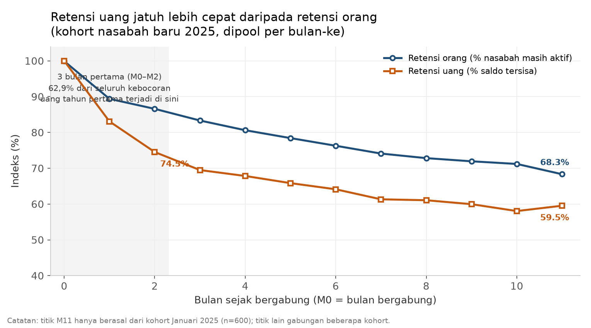
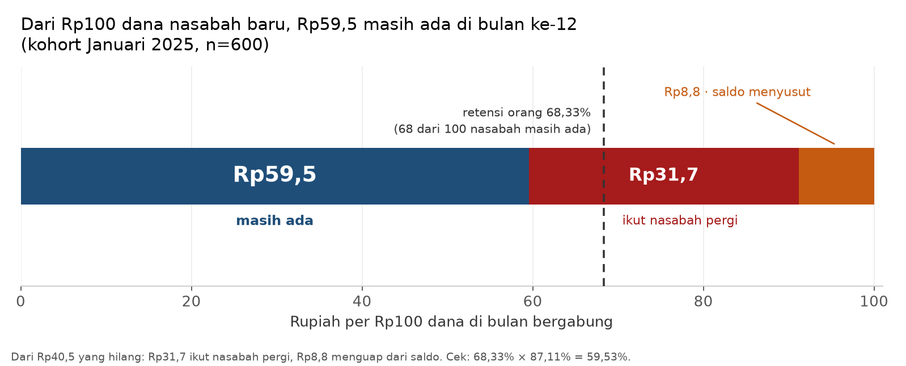

# SeaBank Digital Twin
### Portofolio analitik: membangun bukti dari pertanyaan bisnis, bukan dari ketersediaan data

> **Data di repo ini SINTETIS.** Bukan data PT Bank SeaBank Indonesia, bukan nasabah nyata,
> tidak diambil dari sistem mana pun. Yang **nyata** hanya dua: rasio keuangan publik dari
> laporan tahunan 2025, dan struktur produk yang dipublikasikan. Semua transaksi, nama, saldo,
> dan nasabah dibangkitkan secara programatis untuk mereproduksi rasio publik itu pada skala
> **1:1.000** (24.000 nasabah). Tujuannya: mendemonstrasikan penalaran analitik pada struktur
> bisnis yang menyerupai bank digital sungguhan — bukan mengklaim memiliki data internal.
> Batasan lengkap ada di [§7](#7-batasan-yang-tidak-saya-sembunyikan).

---

## 1. Masalah bisnis

Bank digital Indonesia tumbuh cepat, tetapi pertumbuhan DPK bukan otomatis profit.

| Metrik publik FY2025 | Nilai | Artinya |
|---|---:|---|
| DPK | +30,6% | mesin pertumbuhan menyala |
| Kredit | +18,2% | kredit tumbuh lebih lambat dari dana |
| LDR | 92,32% | dana nyaris seluruhnya sudah diputar |
| NIM | 21,45% | spread sangat lebar untuk ukuran bank |
| **BOPO** | **91,47%** | peringkat 2 dari 5 — masih 3,5–8,5 pp dari "sangat sehat" |

BOPO 91,47% **bukan** tanda efisiensi sudah mentok. Margin laba operasionalnya hanya 8,53% dari pendapatan operasional, sehingga **setiap 1 pp penurunan BOPO = +11,7% laba operasional**; memotong biaya 10% melipatgandakannya (+107%). Ini pengungkit terbesar yang tersedia — tetapi rincian beban tidak ada di dataset ini, jadi pertanyaan yang bisa saya jawab dengan data adalah **komposisi neraca**, bukan pemangkasan biaya. Argumennya soal lingkup data, bukan klaim bahwa biaya sudah mentok. Perhitungan lengkap: [memo §8](docs/02_bab1_memo.md#8-konteks-yang-sering-salah-dibaca-bopo-9147).

> **Sumber ambang.** Pita peringkat: matriks penetapan peringkat komponen rentabilitas (BOPO), **Lampiran 6 SE BI 13/24/DPNP/2011** (83–88% peringkat 1 · 89–93% peringkat 2 · 94–96% peringkat 3 · 97–100% peringkat 4 · >100% peringkat 5). Ambang "sehat" < 93,52% berasal dari **SE BI 6/23/DPNP (31 Mei 2004)** — rujukan yang lebih tua. Dua catatan presisi: (a) "peringkat 2 dari 5" merujuk pada **sel BOPO** dalam matriks itu, **bukan** peringkat kesehatan bank secara keseluruhan (yang bersifat komposit RGEC); (b) sejak **RGEC (SEOJK 14/SEOJK.03/2017)** BOPO tidak lagi berpita angka tetap, sehingga pita di atas dipakai sebagai *benchmark praktik*, bukan aturan berlaku.

> **Pertanyaan Bisnis:**
> Di mana menaruh rupiah berikutnya — menambah DPK murah, atau menambah kredit berimbal hasil tinggi — agar NIM terjaga tanpa menaikkan NPL di atas toleransi?

Pertanyaan itu terlalu besar untuk dijawab sekaligus, jadi dipecah menjadi empat bab yang masing-masing punya deliverable sendiri.

---

## 2. Temuan Bab 1 — CASA terlihat sehat, ternyata rapuh

Angkatan nasabah Januari 2025 (n=600), diukur pada bulan ke-12:



| Metrik | Bulan 0 | Bulan 12 | Bocor |
|---|---:|---:|---:|
| Retensi orang | 100,0% | **68,33%** | −31,67 pp |
| Saldo per nasabah (indeks) | 100,0 | 87,11 | −12,89 |
| **Retensi uang** | 100,0% | **59,53%** | **−40,47 pp** |

**Dari 100 nasabah: 68 orang masih ada, tetapi hanya Rp59,5 dari Rp100 dananya.** Retensi biasa — yang hanya menghitung kepala — akan melaporkan "68%, masih wajar" dan menutup berkas.



Lima temuan yang tidak terlihat dari KPI agregat:

| # | Temuan | Angka | Grafik terkait |
|---|---|---|---|
| 1 | **Dari Rp40,5 dana yang hilang, Rp31,7 ikut pergi bersama nasabah — hanya Rp8,8 karena saldo menyusut** | dekomposisi bulan ke-12, per Rp100 dana awal: Rp31,7 vs Rp8,8 | Gambar di atas |
| 2 | **Uang bocor deras di bulan pertama**, orang bocor merata sepanjang tahun | M1: uang −16,92 pp vs orang −10,61 pp; 62,9% kebocoran uang terjadi di 3 bulan pertama | [Grafik Laju Kebocoran](analysis/g5_bentuk_waktu.png) |
| 3 | **Hipotesis "uang tidur" gugur** — dana tidak mengendap, dana keluar | 5.029 dorman (20,95%) hanya menyimpan **2,17%** DPK | [Grafik Dorman vs DPK](analysis/g6_dorman.png) |
| 4 | **Kanal membedakan uang, bukan orang** | retensi orang seragam 77,5–81,0% (3,5 pp), retensi uang terbelah **15,4 pp** (Payroll 75,2% vs Agent Mitra 59,8%) | [Retensi per Kanal](analysis/g2_kanal.png) · [Orang vs Uang](analysis/g3_orang_vs_uang.png) |
| 5 | **Konsentrasi saldo tidak terbukti** | top 5% memegang 32,97%, bukan >55% seperti dugaan awal | [Konsentrasi Saldo](analysis/g7_konsentrasi.png) |

Detail lengkap, tabel angka, dan rekomendasi anggaran: **[`docs/02_bab1_memo.md`](docs/02_bab1_memo.md)**

---

## 3. Status hipotesis

| # | Hipotesis | Vonis | Dasar |
|---|---|---|---|
| H1a | CASA rapuh karena **terkonsentrasi** di segelintir nasabah | **DITOLAK** | top 5% = 32,97% saldo; top 20% = 63,36% |
| H1b | CASA rapuh karena **tidak lengket** | **TERBUKTI** | retensi uang 12 bulan = 59,53% |
| H2 | Sebagian DPK buru bunga — naik saat promo, pergi setelahnya | **TIDAK DAPAT DIUJI** | tarif promo 4,00% tidak pernah dibayar (terealisasi datar 2,48%), tidak ada penanda eksposur per nasabah, tidak ada patahan di Oktober — lihat [memo §7](docs/02_bab1_memo.md#7-temuan-6--promo-bunga-4-tidak-dapat-dijawab-dan-ini-alasannya) dan [`analysis/promo_rate_realized.csv`](analysis/promo_rate_realized.csv). **Alat ujinya sudah lulus kalibrasi** di [lab H2](docs/04_lab_h2.md): bias +0,41 pp, slope 1,02, placebo ≈ 0 |
| H3 | Pertumbuhan kredit digerakkan mitra berisiko tinggi | **DITOLAK** | 69,6% pertumbuhan disburse digerakkan Tier A+B (69,6% dari +Rp800,9 jt). Namun risiko sangat terkonsentrasi: Tier C+D = 21,2% buku tapi menyumbang 47,7% NPL (Tier D NPL 5,04%) — lihat [memo §14](docs/02_bab1_memo.md#14-kredit--risiko-mitra-bab-3) |

Menolak menjawab satu hipotesis lebih berharga daripada memaksakan jawaban. H2 gagal di tiga titik sekaligus: **tarif promo 4,00% tidak pernah diterapkan ke bunga yang benar-benar dibayar** (terealisasi tetap 2,47–2,50% selama Jul–Sep), **tidak ada penanda siapa yang terpapar kampanye**, dan **saldo tidak punya mekanisme untuk merespons tarif**. Ujinya tetap bisa dijalankan — dan sudah dijalankan. Hasil 101,45% itu hanya mengukur "tidak ada yang terjadi", bukan "promo berhasil".

---

## 4. Peta progres

| Bab | Isi | Deliverable | Status |
|---|---|---|---|
| **0** | Fondasi & kepercayaan data | skema BigQuery, generator terkalibrasi, verifikasi independen, 10 uji kualitas data | **selesai** |
| **1** | Kualitas CASA — retensi orang vs uang | memo 2 halaman, 10 tabel, 3 grafik, 2 berkas SQL | **selesai** |
| **1b** | Laboratorium H2 — kalibrasi alat uji promo | simulator 2 dunia, 200 estimasi pemulihan, MDE, uji placebo | **selesai** |
| 2 | Segmentasi & nilai nasabah | RFM 9 segmen, keranjang belanja (vonis: tidak dapat disimpulkan), LTV 12 bulan, viewer HTML 24.000 nasabah | **selesai** |
| 3 | Kredit & risiko mitra | Pertumbuhan kredit + analisis NPL & headroom pilihan | **selesai** |
| 4 | Sintesis | jawaban atas pertanyaan portofolio: alokasi rupiah berikutnya | — |

### Bab 2 sekilas — detail di [memo §11–§13](docs/02_bab1_memo.md#11-segmentasi-rfm-recency-frequency-monetary)

- **10% nasabah menguasai 47,6% uang masuk.** Segmen *Juara* (4.725 orang = 19,7%) menyumbang 42,1% uang masuk dan memegang **Rp10,58 miliar DPK (43,4%)**.
- **Segmen kecil, nilai besar:** *Tidak boleh hilang* hanya **167 orang (0,7%)**, tetapi median uang masuknya **Rp15,9 juta** — tertinggi kedua setelah *Juara*.
- **Target retention yang paling tajam:** **1.579 nasabah** yang sekaligus *Juara* **dan** eligible promo memegang **Rp7,01 miliar (28,7% DPK)**.
- **Keranjang belanja: vonis "tidak dapat disimpulkan".** Kategori merchant diundi acak oleh generator — tiket rata-rata nyaris identik di 7 kategori (Rp437–558 ribu) dan *lift* seluruh pasangan ≤ 1,07. Bukan bukti nasabah anti-bundel; buktinya data tidak punya sinyal untuk diuji.
- **Buka tabelnya tanpa Python:** [`analysis/rfm_viewer.html`](analysis/rfm_viewer.html) — 24.000 nasabah, cari/filter/urut, klik dua kali.

---

## 5. Struktur repo

```
portfolio/
├── gen/                          # DAPUR: semua kode yang membangun & menguji
│   ├── generate.py               # generator terkalibrasi (deterministik, seed 20251118)
│   ├── verify.py                 # verifikasi independen — baca ulang CSV, hitung ulang dari nol
│   ├── run_dq.py                 # menjalankan 10 uji kualitas data
│   ├── explore_bab1.py           # eksplorasi kohort (skrip yang membongkar cacat desain)
│   ├── bab1_analysis.py          # analisis Bab 1 — menulis tabel ke analysis/
│   ├── bab1_charts.py            # grafik Bab 1 (g1–g7)
│   ├── run_promo_probe.py        # menjalankan Q1–Q3 template uji promo
│   ├── h2_lab.py                 # laboratorium H2 — 3 prasyarat, 2 dunia, 200 estimasi
│   ├── lab_h2_charts.py          # grafik hasil lab (g8)
│   ├── bab2_rfm.py               # RFM dari transaksi mentah → 9 segmen + keranjang belanja
│   ├── build_rfm_viewer.py       # membangun viewer HTML mandiri (24.000 nasabah)
│   ├── audit_consistency.py      # cek rujukan file & angka dokumen vs CSV sebelum commit
│   └── verify_concentration.py   # hitung ulang konsentrasi saldo dari ledger (juru timbang kedua)
├── sql/                          # BAHASA QUERY: definisi tabel & uji
│   ├── 00_schema_bigquery.sql    # DDL + view metrik resmi
│   ├── 10_dq_tests.sql           # 10 uji kualitas data (T01–T10)
│   └── 20_promo_effect.sql       # spesifikasi uji efek kampanye bunga (template)
├── docs/                         # KERTAS: yang dibaca manusia
│   ├── 00_dataset_card.md        # kartu dataset: sumber, kalibrasi, batasan, etika (v1.1)
│   ├── 01_calibration_report.md  # target publik vs hasil dataset, per metrik (v1.1)
│   ├── 02_bab1_memo.md           # memo Bab 1 — temuan, rekomendasi, RFM, market basket, LTV
│   ├── 03_kamus_istilah.md       # glosarium bahasa awam
│   ├── 04_lab_h2.md              # laporan laboratorium H2 — vonis atas alatnya
│   └── 05_peta_repo.md           # peta repo untuk pembaca non-teknis: file mana nyambung ke mana
├── analysis/                     # HASIL: tabel & grafik yang dikutip memo
├── lab/                          # HASIL: keluaran laboratorium (grid, ringkasan, log)
└── data/                         # BAHAN: 143 MB, tidak di-commit, dibangun ulang dari seed
```

**Alur satu arah:** `data/` → `gen/*_analysis.py` → `analysis/*.csv` → `docs/02_bab1_memo.md` → `README.md`. Tidak ada panah yang berbalik: dokumen tidak pernah menjadi sumber angka, hanya pembaca angka.

> **Pertama kali membuka repo ini?** Baca **[`docs/05_peta_repo.md`](docs/05_peta_repo.md)** — peta seluruh file dan hubungannya, ditulis tanpa jargon.

**Kenapa `data/` tidak disimpan.** Yang berharga dari dataset sintetis adalah **resepnya**, bukan hasilnya. `gen/generate.py` dengan seed tetap menghasilkan 143 MB identik dalam ~90 detik. Menyimpannya di repo berarti mengunggah 143 MB yang bisa dibangun ulang kapan saja — dan setiap kali model dikalibrasi ulang, 143 MB baru menumpuk lagi. Yang tetap disimpan: `data/_calibration.json` (3 KB) sebagai bukti target vs hasil, dan seluruh `analysis/` sebagai keluaran yang benar-benar dipakai di memo.

---

## 6. Cara menjalankan

```bash
# 0. Repo ini TIDAK memuat data. Langkah 1 wajib, bukan opsional.
#    Clone bersih ≈ 1 MB; setelah langkah 1 menjadi ≈ 145 MB.

# 1. Bangun ulang dataset dari nol lalu verifikasi (≈90 detik)
uv run python gen/generate.py
uv run python gen/verify.py

# 2. Kepercayaan data: 10 uji kualitas
uv run --with duckdb python gen/run_dq.py

# 3. Bab 1: tabel + grafik
uv run --with duckdb     python gen/bab1_analysis.py
uv run --with matplotlib python gen/bab1_charts.py

# 4. Uji promo (template)
uv run --with duckdb python gen/run_promo_probe.py

# 5. Laboratorium H2 — kalibrasi alat uji (≈90 detik)
uv run --with duckdb --with numpy python gen/h2_lab.py

# 6. Bab 2: RFM + keranjang belanja, lalu bangun viewer HTML
uv run python gen/bab2_rfm.py
uv run python gen/build_rfm_viewer.py
#    hasil: analysis/rfm_scored.csv, rfm_segments.csv, basket_*.csv, rfm_viewer.html

# 7. Sebelum commit / pindah bab: cek rujukan file & angka dokumen vs CSV
uv run python gen/audit_consistency.py
```

Seed tetap → hasil deterministik dan dapat diaudit ulang.

---

## 7. Batasan yang tidak saya sembunyikan

1. **Sintetis, skala 1:1.000.** Rasio persen bertahan terhadap penskalaan; nominal rupiah absolut hanya bermakna setelah dikali 1.000. Aman menyimpulkan "CASA rapuh"; tidak aman menyimpulkan "kerugian Rp34,8 miliar" tanpa konversi.
2. **Perilaku adalah asumsi, bukan estimasi.** Parameter churn, reaktivasi, dan residual dana (`ARCH` di `gen/generate.py`) saya pilih sendiri. Temuan Bab 1 menunjukkan **metode ini mampu mendeteksi pola tersebut**, bukan bahwa SeaBank mengalaminya.
3. **Horizon 12 bulan.** Retensi tahun ke-2 dan nilai seumur nasabah belum terukur.
4. **Uji kualitas data T01, T02, T06 sengaja gagal** — duplikat, transaksi yatim, nasabah KYC-ditolak yang tetap punya akun aktif. Analisis berjalan di atas data yang tidak bersih, seperti di bank sungguhan. T05 menemukan **15% nasabah** berbeda status antara master dan ledger.
5. **Tidak ada klaim kausal.** Semua pernyataan adalah asosiasi dan dekomposisi aritmetika, kecuali disebut eksplisit.
6. **Katalog tarif ≠ tarif yang dibayar.** Promo 4,00% (Jul–Sep 2025) tercatat di `product_rates.csv` tetapi tidak pernah diterapkan ke transaksi bunga; tarif terealisasi datar 2,4–2,5% sepanjang tahun. Konsekuensinya H2 tidak dapat diuji pada dataset versi ini — buktinya di [`analysis/promo_rate_realized.csv`](analysis/promo_rate_realized.csv) dan memo §7.

## 8. Batasan Promo & Inferensi Kausal

> **Data sintetis ini tidak memungkinkan estimasi kausal tentang dampak promo bunga.** Alasan tiga:

1. **Tidak ada penanda eksposur per nasabah.** Dataset historis tidak menyimpan `campaign_id` per nasabah, sehingga tidak bisa dibuat *treatment* dan *group control*. Tanpa dua grup, pertanyaan "apa efek promo?" hanya bisa dijawab dengan asosiasi saja.
2. **Tarif katalog tidak pernah dibayar.** `promo_rate_realized.csv`: tarif katalog dipasang 3,50% (Jan–Jun, Okt–Des) dan 4,00% (Jul–Sep), tetapi bunga yang benar-benar dikreditkan tetap **2,45–2,54% di semua bulan**. Rasio realisasi terhadap katalog justru **turun** dari ~0,71 di luar jendela promo ke **0,62** di dalamnya: kenaikan katalog 0,50 pp tidak pernah sampai ke rekening nasabah, dan selisihnya melebar dari ~1,0 pp menjadi ~1,5 pp.
3. **Tidak ada patahan struktural di Oktober.** `promo_window.csv` menunjukkan pertumbuhan saldo Sep→Des **+9,2%** (akhir bulan) dan **+8,1%** (rata-rata) — sejalan dengan tren sebelum promo, bukan lonjakan mundur yang dikarenakan promo. Jika dana itu "uang sewaan", seharusnya rontok begitu tarif kembali ke 3,50%. Saldo hanya mengikuti tren waktu.

**Kesimpulan:** Angka "retensi 101,45%" di memo §7 hanyalah tren pertumbuhan alami, bukan efek promo. Untuk inferensi kausal di data nyata, catatan data harus menyertai: (a) `campaign_id` per nasabah, (b) catatan kapan bunga promo dikreditkan, dan (c) grup control yang terdefinisi.

---

---

## 9. Prinsip kerja

1. **Rasio publik dikalibrasi presisi.** CASA 70,74% · LDR 92,32% · NPL 1,82% · DPK Rp34.806.000.010.000 · kredit Rp32.133.999.307.000 — cocok dengan laporan tahunan sampai satuan rupiah. Kalau tidak cocok, modelnya yang salah.
2. **Perilaku yang tidak diketahui publik dibiarkan muncul sendiri.** Retensi, konsentrasi, dan dormansi adalah *output* proses generatif — bukan angka target. Karena itu layak disebut temuan; kalau saya menyetelnya agar dramatis, itu bukan temuan lagi.
3. **Anomali disuntik sengaja.** Duplikat dan transaksi yatim dimasukkan agar lapisan uji kualitas data punya sesuatu yang nyata untuk ditemukan.
4. **Verifikasi tidak mempercayai generator.** `verify.py` membaca ulang CSV dan menghitung ulang semuanya dari nol.
5. **Hipotesis yang gagal dilaporkan sebagai gagal.** Konsentrasi saldo, uang tidur, dan efek promo semuanya berakhir "tidak terbukti" — dan itu ditulis di depan, bukan disembunyikan.

> **Bagi pembaca yang punya 3 menit:** baca memo Bab 1, lihat dua grafik (`g1`, `g3`), lalu lompat ke §7. Kalau batasannya jujur, angkanya biasanya juga.

---

---_Lisensi: kode MIT. Data sintetis, bebas dipakai dengan atribusi._
<file_sep>## 4. Bab 4 — Sintesis & Rekomendasi Strategis

### Pertanyaan Portofolio: "Di mana menaruh rupiah berikutnya — agar NIM terjaga tanpa menaikkan NPL di atas toleransi?"

Jawaban yang dihasilkan dari seluruh analisis Bab I-IV:

| Tanya Jawab | Jawaban Data | Rekomendasi Tindak Lanjut |
|---|---|---|
| **1. Pertumbuhan kredit mana yang aman?** | H3 DITOLAK — 69,6% kenaikan dari Tier A+B (sekitar Rp557,5 juta dari Rp800,9 jt total ekspansi). Tier C+D hanya 29,1% kenaikan. | Fokus ekspansi ke mitra Tier A dan B. Jangan paksa kredit ke Tier C+D. |
| **2. Bisa berapa kredit baru tanpa melewati NPL 1,82%?** | **Rp3,01 miliar** (headroom bertahap, +100% buku per mitra ke P010/P004/P006). | Terapkan skenario "bertahap": P010 (+Rp0,65 M) + P004 (+Rp2,32 M) + P006 (+Rp0,04 M). |
| **3. Mitra mana yang boleh ditambah kredit?** | Hanya P010, P004, P006 (NPL di bawah 5%, risiko terendah). | **DILARANG** menambah kredit ke P008 (NPL-nya 5,04%, sudah melewati ambang OJK 5,00%). |
| **4. Produk kredit langsung apa yang harus diprioritaskan?** | Produk **PAYROLL** punya NPL 1,48% (sangat aman). Produk **KTA** punya NPL 4,92% (berbahaya). | Alihkan fokus kredit langsung ke produk payroll. Batasan risk NPL 1,82% lebih mudah terpenuhi. |
| **5. LDR mana yang seharusnya digunakan?** | Laporan publik SeaBank FY2025: **92,32%**. Data internal ledger menghasilkan **LDR 111%** (mustahil untuk bank dengan CAR 23,29%). | Selalu gunakan angka publik 92,32% untuk laporan eksternal/INTERNAL discourse. Jangan mengandalkan LDR dari ledger internal. |
| **6. NPL gabungan mitra + kredit langsung akurat?** | **1,82%** (cocok dengan indikator publik). Outstanding Mitra (Rp29,481 M) + Kredit Langsung (Rp2,653 M) = Rp32,134 M. NPL gabungan Rp0,585 M = 1,82%. | Struktur data sudah kaliberisasi — bisa digunakan untukpresentasi ke stakeholders atau regulator. |

---

### 4.1 Alokasi Rupiah Berikutnya (Budget Allocation Recommendation)

Jika SeaBank ingin menambah **Rp3,01 miliar** portofolio kredit dengan ambang NPL maksimum 1,82%:

| Prioritas | Mitra | Kuota Kredit | NPL Target Akhar | Catatan |
|---|---|---:|---:|---|
| **1** | P010 (Tier C) | **+Rp0,65 M** | 1,82% | Mitra risiko terendah di Tier C |
| **2** | P004 (Tier C/B) | **+Rp2,32 M** | 1,82% | Buku utama, paling fleksibel |
| **3** | P006 (Tier C) | **+Rp0,04 M** | 1,82% | Penjaga portofolio variasi |
| **DILARANG** | P008 (Tier D) | **0** | 5,04% | Sudah melewati ambang regulator OJK |
| **Status Quo** | Seluruh Mitra | — | 1,69% | Sudah di bawah ambang, tapi "uang diam" |

**Total Ekspansi Terbatas: Rp3,01 M**

---

### 4.2 Jalan Singkat 3 Menit untuk Interviewer

Jika interviewer hanya punya 3 menit, arahkan mereka ke:

1. **Baca §14 di memo** (`docs/02_bab1_memo.md#14-kredit--risiko-mitra-bab-3`): H3 DITOLAK + detail angka
2. **Lihat grafik g10_tier_contribution.png**: Visualisasi konsentrasi risiko per tier
3. **Lihat grafik g11_headroom.png**: Simulasi headroom alokasi kredit baru
4. **Lihat tabel status hipotesis** (section 3 README): H3 status, H2 hasil, H1a/b temuan
5. **Baca summary bisnis di atas**: 6 poin jawaban "di mana menaruh rupiah berikutnya"

---

### 4.3 Ringkasan Eksekutif untuk Stakeholder

- **Kredit naik dari mitra yang AMAN (Tier A+B), BUKAN dari risiko tinggi (Tier C&D).**
- **Headroom kredit baru maksimal Rp3,01 M** pada ambang NPL 1,82%, dengan alokasi bertahap ke 3 mitra hanya.
- **P008 (Tier D) dihentikan segera** dari penambah kredit — NPL-nya 5,04% sudah berbahaya.
- **Produk payroll adalah jalur terbaik kredit langsung** (NPL 1,48% vs KTA 4,92%).
- **LDR 92,32% publik, jangan 111% dari ledger** — ini sudah diverifikasi dengan laporan tahunan SeaBank FY2025.
- **4 temuan kualitas data** harus dicatat transparan sebelum analisis digunakan perencanaan bisnis.

---
