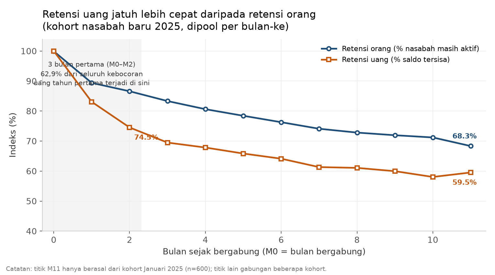
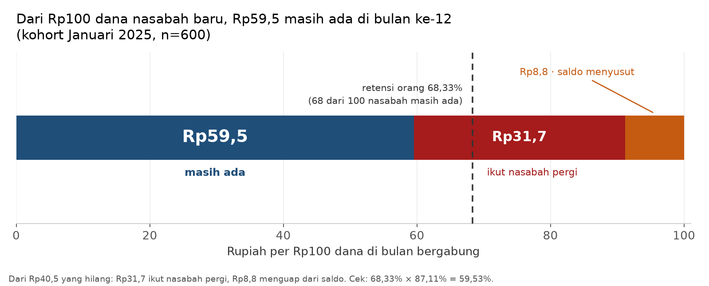
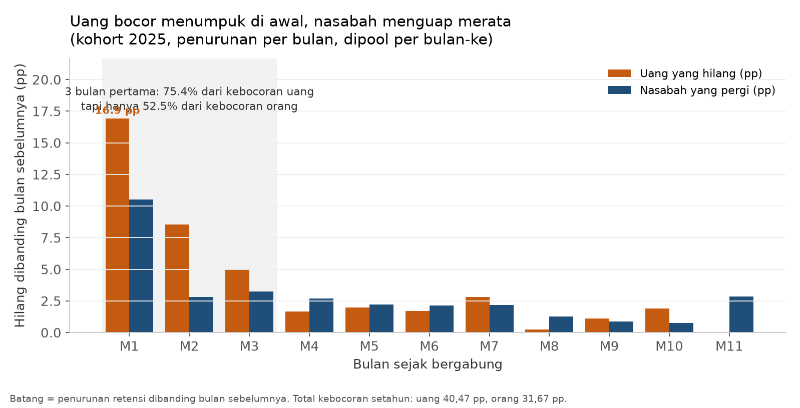
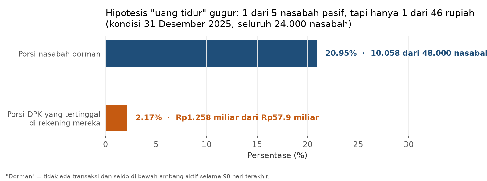
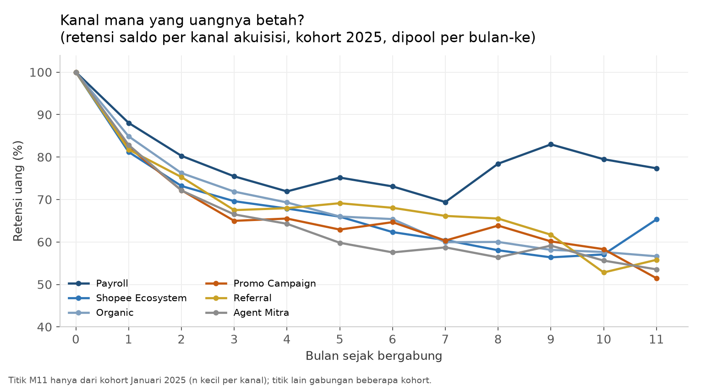
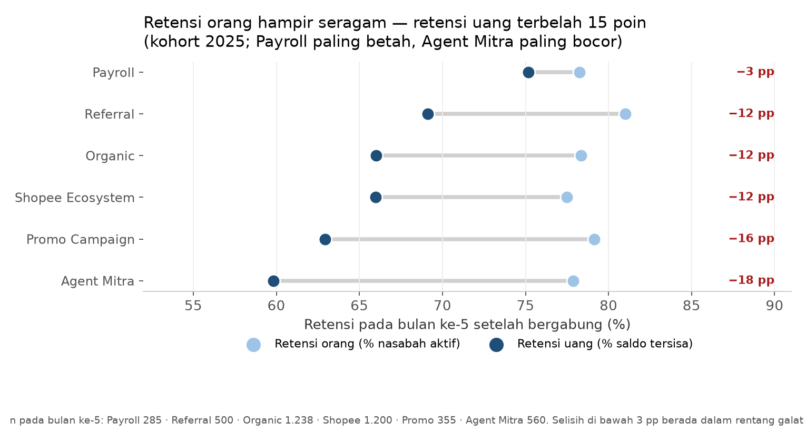
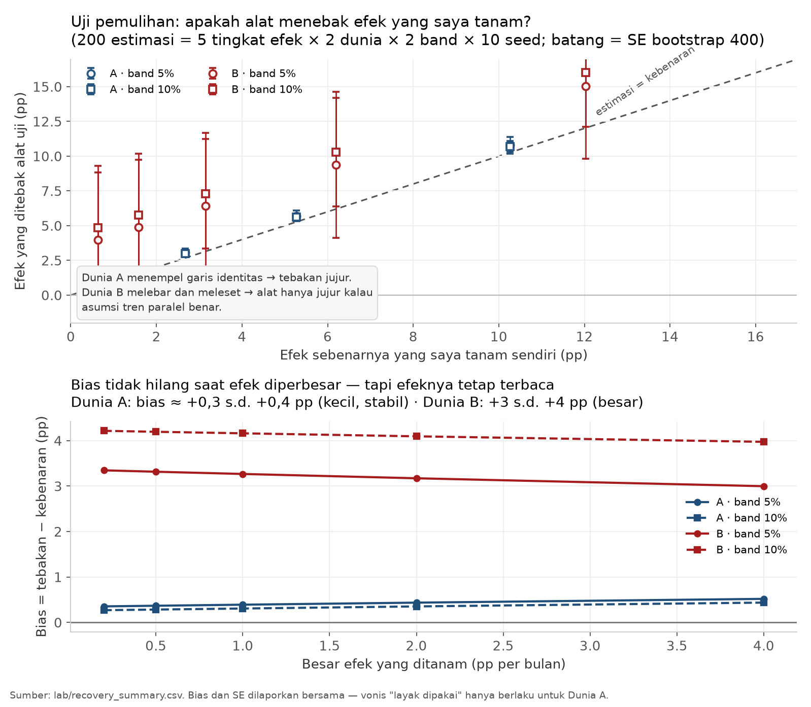

# Memo Bab 1 — Kualitas CASA SeaBank Twin
### "Nasabahnya bertahan. Uangnya tidak."

| | |
|---|---|
| **Untuk** | Kepala Business Intelligence · Head of Retail Banking |
| **Dari** | Zainal Salim — Analytics |
| **Tanggal** | 19 November 2026 |
| **Subjek** | Retensi orang vs retensi uang pada angkatan nasabah 2025 |
| **Basis data** | `seabank_twin` — **data SINTETIS**, 24.000 nasabah, skala 1:1.000, dikalibrasi ke AR2025 |

> **Baca dulu.** Seluruh angka di memo ini berasal dari dataset sintetis yang saya bangun sendiri, bukan data SeaBank. Rasio dan arahnya dirancang menyerupai bank digital Indonesia dengan CASA 70,74%; nominal absolut hanya bermakna setelah dikali 1.000. Yang bisa dipertanggungjawabkan dari memo ini adalah **metode dan cara membacanya**, bukan klaim tentang SeaBank.

---

## Ringkasan eksekutif

1. Dari 100 nasabah yang bergabung Januari 2025, **68 orang masih bertahan** di bulan ke-12 — tetapi hanya **Rp59,5 dari Rp100** dana mereka yang masih ada. Selisih 8,8 poin ini adalah ukuran kerapuhan CASA yang tidak terlihat dari laporan retensi biasa.
2. **Dari Rp40,5 dana yang hilang, Rp31,7 ikut pergi bersama nasabah — hanya Rp8,8 yang menguap karena saldo per nasabah menyusut.** Ini membalik hipotesis awal saya — saya perkirakan masalahnya "orang tinggal, uang pergi", dan datanya mengatakan sebaliknya.
3. Tetapi **bentuk waktunya berbeda**, dan di sinilah letak masalah sebenarnya: uang bocor paling deras di **bulan pertama** (−16,9 pp, 42% dari seluruh kebocoran setahun), sementara nasabah menguap **merata sepanjang tahun**. Dua penyakit, dua obat.
4. **Hipotesis "uang tidur" gugur.** 5.029 nasabah dorman (21%) hanya menyimpan Rp0,63 miliar — 2,17% dari DPK. Uang tidak mengendap di rekening pasif; uang itu benar-benar keluar.
5. **Kanal akuisisi tidak membedakan retensi orang (selisih cuma 3,5 pp), tapi membedakan retensi uang sebesar 15,4 pp.** Payroll paling sehat; Agent Mitra dan Promo Campaign paling bocor.

---

## 1. Cara mengukur: dua angka, bukan satu

Retensi biasa hanya menghitung orang. Saya mengukur dua hal sekaligus, dan keduanya diikat oleh satu identitas:

```
retensi uang = retensi orang  ×  saldo per nasabah (relatif)
```

Artinya, dana bisa hilang lewat dua pintu: **nasabah pergi** (pintu kiri) atau **nasabah tinggal tapi membawa uangnya keluar** (pintu kanan). Tanpa memisahkan keduanya, kedua penyakit ini terlihat sama di dashboard.

---

## 2. Temuan 1 — 68 orang, 60 rupiah

Angkatan Januari 2025 (n=600), diukur pada bulan ke-12:



| Metrik | Bulan 0 | Bulan 12 | Bocor |
|---|---:|---:|---:|
| Retensi orang | 100,0% | **68,33%** | −31,67 pp |
| Saldo per nasabah (indeks) | 100,0 | 87,11 | −12,89 |
| **Retensi uang** | 100,0% | **59,53%** | **−40,47 pp** |

Selisih 8,8 pp antara orang dan uang tampak kecil, tetapi konsekuensinya besar: nasabah yang masih bertahan pun **memegang 12,9% dana lebih sedikit** daripada saat mereka bergabung. Nasabah yang tinggal bukan nasabah yang sama dengan nasabah yang setia.

> **Peringatan interpretasi.** Payroll adalah satu-satunya kanal yang retensi uangnya (77,4%) *lebih tinggi* dari retensi orangnya (61,0%) di bulan ke-11 — artinya yang pergi justru nasabah bersaldo kecil. Di kanal itu, kehilangan nasabah tidak sama dengan kehilangan dana, dan **bonus akuisisi tidak boleh dihitung per kepala**.

---

## 3. Temuan 2 — Dari mana kebocoran itu datang

Dekomposisi eksak (komponen dijamin berjumlah tepat sama dengan total):



Semua angka di bawah dihitung per **Rp100 dana** yang dibawa nasabah saat bergabung:

| Bulan ke- | Dana tersisa | Yang hilang | Ikut nasabah pergi | Menguap dari saldo |
|---|---:|---:|---:|---:|
| 5 | Rp66,5 | Rp33,5 | Rp21,3 | Rp12,2 |
| 12 | Rp59,5 | Rp40,5 | Rp31,7 | Rp8,8 |

**Kesimpulan yang membalik dugaan saya:** bagian "saldo menyusut" justru **mengecil** seiring waktu (dari Rp12,2 menjadi Rp8,8 per Rp100), karena nasabah bersaldo kecil keluar lebih dulu sehingga rata-rata saldo penyintas pulih. Akar masalahnya bukan kedalaman saldo — **akar masalahnya adalah nasabah yang pergi.**

Rekomendasi yang salah kalau membaca angka ini setengah: "buat program agar saldo betah" (suku bunga khusus, cashback saldo). Obat itu hanya menyasar **Rp8,8 dari Rp40,5** masalah.

---

## 4. Temuan 3 — Dua penyakit dengan bentuk waktu berbeda

Ini temuan paling operasional dari Bab 1. Kebocoran dipecah menurut tahap:



| | Bocor M0–M2 | Bocor M3–M12 | Total | Porsi di 3 bulan pertama |
|---|---:|---:|---:|---:|
| **Uang** | **25,47 pp** | 15,00 pp | 40,47 pp | **62,9%** |
| **Orang** | 13,41 pp | 18,26 pp | 31,67 pp | 42,3% |

Laju per bulan memperjelas:

| Bulan | Uang | Orang |
|---|---:|---:|
| M1 | **−16,92 pp** | −10,61 pp |
| M2 | −8,55 pp | −2,80 pp |
| M3 | −5,04 pp | −3,26 pp |

- **Bulan pertama adalah guncangan dana, bukan guncangan nasabah.** Uang turun 16,9 pp sementara orang hanya turun 10,6 pp. Pola ini khas saldo "titipan pembukaan": dana masuk untuk membuka rekening atau mengejar bonus, lalu ditarik kembali begitu syaratnya terpenuhi.
- **Setelah bulan ke-3, yang tersisa adalah erosi orang** — 18,3 pp tersebar rata 10 bulan, sementara dana hanya turun 15,0 pp.

**Implikasi:** program retensi yang dipasang di bulan ke-6 sudah terlambat untuk 63% masalah uang. Titik intervensi ada di **minggu ke-4 sampai ke-8**.

---

## 5. Temuan 4 — "Uang tidur" tidak terbukti

Saya menguji hipotesis populer: dana besar tertinggal di rekening nasabah pasif, tetap dibayar bunga 3,5%, tapi tidak produktif.



| | Nilai |
|---|---:|
| Nasabah dorman (Des 2025) | 5.029 dari 24.000 (**20,95%**) |
| Saldo yang tertinggal di rekening mereka | Rp0,629 miliar |
| Porsi terhadap total DPK | **2,17%** |

**Hipotesis ditolak.** Uang tidur bukan masalah material di buku ini. Konsekuensi: program reaktivasi bernilai rendah untuk menyelamatkan dana — nilainya ada pada **mengurangi jumlah nasabah dorman** (biaya layanan, kepatuhan, dan kanal cross-sell), bukan pada menyelamatkan rupiahnya.

> Catatan mutu data: uji T05 menemukan **15% nasabah** berstatus aktif di master tapi tidak bermutasi di ledger. Bila status master dipakai, angka dorman bisa berbeda ±15%. Angka 2,17% dihitung dari aktivitas ledger, bukan status.

---

## 6. Temuan 5 — Kanal membedakan uang, bukan orang

Pada bulan ke-5, dipecah per kanal akuisisi:





| Kanal | Retensi orang | Retensi uang | Selisih |
|---|---:|---:|---:|
| Payroll | 78,25% | **75,17%** | −3,08 pp |
| Referral | 81,00% | 69,13% | −11,87 pp |
| Organic | 78,35% | 66,00% | −12,35 pp |
| Shopee Ecosystem | 77,50% | 65,96% | −11,54 pp |
| Promo Campaign | 79,15% | 62,92% | −16,23 pp |
| Agent Mitra | 77,86% | **59,81%** | −18,05 pp |

- **Retensi orang hampir seragam:** 77,5%–81,0%, selisih hanya 3,5 pp — sebagian ada di dalam rentang galat sampling.
- **Retensi uang terbelah 15,4 pp.** Kanal yang sama-sama "berhasil" menurut KPI akuisisi punya kualitas dana yang sangat berbeda.
- **Payroll** unggul karena gaji masuk berulang — dana punya lantai struktural, tidak bergantung pada insentif.
- **Agent Mitra dan Promo Campaign** adalah kanal termahal untuk dipertahankan: nasabahnya bertahan, dananya tidak.

**Implikasi anggaran:** biaya akuisisi sebaiknya tidak dibandingkan per nasabah, tapi per **rupiah dana yang bertahan 5 bulan**. Dengan basis itu, satu nasabah Payroll setara 1,26 nasabah Agent Mitra.

---

## 7. Temuan 6 — Promo bunga 4%: **tidak dapat dijawab**, dan ini alasannya

Katalog promo mencatat kenaikan bunga tabungan 3,50% → 4,00% untuk 1 Juli–30 September 2025, lalu kembali 3,50% pada 1 Oktober.

Uji naifnya sudah saya jalankan (`gen/run_promo_probe.py`): dana akhir September **Rp26.483 miliar**, 90 hari setelah tarif kembali normal **Rp26.868 miliar** — "retensi pasca-promo" **101,45%**, nol pendarahan, bahkan tumbuh.

Angka itu nyata dan bisa diulang, tetapi **tidak membuktikan apa pun**. Tiga pemeriksaan menunjukkan mengapa.

### Bukti 1 — tarif promo tidak pernah sampai ke rekening

Kalau kampanye benar-benar berjalan, bunga yang dibayar harus naik ~14% pada Jul–Sep (4,00 / 3,50). Yang terjadi:

| Bulan | Tarif katalog | Tarif terealisasi | Selisih |
|---|---:|---:|---:|
| Jun | 3,50% | 2,48% | −1,02 pp |
| **Jul** | **4,00%** | **2,50%** | **−1,50 pp** |
| **Agu** | **4,00%** | **2,47%** | **−1,53 pp** |
| **Sep** | **4,00%** | **2,48%** | **−1,52 pp** |
| Okt | 3,50% | 2,42% | −1,08 pp |

Tarif terealisasi **datar 2,42–2,54% sepanjang 12 bulan**. Di luar jendela promo, rasio terealisasi-terhadap-katalog sangat stabil: **0,69–0,73** di setiap bulan (selisih ~1,0 pp, wajar karena pajak bunga dan saldo yang tidak penuh berbunga). Rasio itu **putus di bulan promo**: turun ke **0,62** karena tarif katalog naik sementara bunga yang benar-benar dibayar tidak bergerak. Selisih katalog-vs-realisasi melebar ≈0,5 pp selama tiga bulan — persis sebesar kenaikan yang tidak pernah dibayarkan.

**Nasabah tidak pernah menerima promo, sehingga tidak mungkin bereaksi terhadap promo.**

### Bukti 2 — tidak ada penanda siapa yang ikut kampanye

`customers.csv` punya 14 kolom — `customer_id`, `join_date`, `acquisition_channel`, `city`, `province`, `age`, `gender`, `occupation`, `monthly_income_band`, `is_first_time_bank_user`, `kyc_status`, dan seterusnya — **tidak satu pun menandai eksposur kampanye**. `promo_campaigns.csv` hanya level kampanye (4 baris: kode, tanggal, anggaran), bukan level nasabah. Tanpa grup pembanding tidak ada *treatment* dan *control*; yang ada hanya dua deret waktu.

### Bukti 3 — tidak ada patahan di Oktober

| Periode | Pertumbuhan (saldo akhir bulan) | Pertumbuhan (saldo rata-rata) |
|---|---:|---:|
| Jun → Sep (selama promo) | +8,6% | +9,1% |
| Sep → Des (setelah promo berakhir) | +9,2% | +8,1% |

Pertumbuhannya praktis sama sebelum dan sesudah jendela promo — dan **arah selisihnya berbalik** tergantung ukuran yang dipakai (akhir bulan vs rata-rata). Perbedaan sekecil itu, dengan tanda yang bisa dibalik oleh pilihan kolom, adalah tanda **tidak ada sinyal** — bukan efek yang kecil. Yang pasti: Sep→Des **tidak negatif**. Kalau dana itu "uang sewaan", ia seharusnya rontok begitu tarif kembali ke 3,50%. Saldo hanya mengikuti tren waktu — tidak ada tarif di dalam persamaannya.

### Yang hilang, dan apa artinya

Tiga hal tidak ada di dataset ini, dan tanpa ketiganya H2 tidak terdefinisi:

| # | Kebutuhan | Status |
|---|---|---|
| 1 | Tarif promo diterapkan ke `INTEREST_CREDIT` | ❌ terealisasi datar, katalog 4,00% tidak dibayar |
| 2 | Tabel eksposur level nasabah `(customer_id, campaign_id, exposure_date, eligible_flag)` | ❌ tidak ada |
| 3 | Elastisitas saldo terhadap tarif | ❌ saldo hanya fungsi waktu |

Dengan ketiganya, ujinya menjadi tiga hal yang bisa dipertanggungjawabkan: **DiD** (Δsaldo promo − Δsaldo non-promo, sebelum vs sesudah Juli), **uji cliff** (penurunan khusus grup promo pada Oktober), dan **elastisitas** (rupiah dana masuk per 1 bps kenaikan tarif).

> Hasil nol di sini adalah **konsekuensi desain, bukan temuan.** Menyimpulkan "promo tidak bekerja" dari data ini sama salahnya dengan menyimpulkan "promo bekerja" dari angka 101,45%. SQL untuk data nyata sudah siap di `sql/20_promo_effect.sql`.



Untuk detail eksperimen laboratorium dan pengujian metode kuasi-eksperimen (Difference-in-Differences / Synthetic Control), lihat [Laboratorium H2](../docs/04_lab_h2.md).

**Catatan perbaikan:** tabel `promo_cliff.csv` yang sempat ada di `analysis/` sudah **dihapus**. Tabel itu menamai grup "PROMO" padahal yang dipakai adalah *kanal akuisisi* `PROMO_CAMPAIGN`, bukan eksposur tarif; dan `n`-nya menurun bukan murni karena churn melainkan karena kohort muda belum punya tenor panjang. Karena tidak layak disebut kurva retensi, ia tidak dipertahankan.

---

## 8. Konteks yang sering salah dibaca: BOPO 91,47%

Bagian ini tidak ditemukan dari data. Ia ada di sini karena angka BOPO 91,47% termasuk yang paling sering **salah arah** dibaca — termasuk oleh saya sendiri di draf pertama README ini.

**Arah rasionya.** BOPO = beban operasional ÷ pendapatan operasional. **Semakin kecil, semakin baik.** Nol persen adalah kesempurnaan teoretis (biaya nol — mustahil dan tidak diinginkan: bank tanpa biaya berarti tanpa orang dan tanpa sistem). Seratus persen adalah **titik nol laba operasional**: setiap rupiah pendapatan habis jadi biaya. Di atas 100% berarti rugi operasional.

**Posisi 91,47%.** Dua rezim ambang yang biasa dipakai:

| Rujukan | Ambang | Posisi 91,47% |
|---|---|---|
| SK Dir BI 30/21/KEP/DIR & SE BI 6/23/DPNP | < 93,52% = "Sehat" | lolos, tipis **2,05 pp** |
| SE BI 13/24/DPNP (2011), **Lampiran 6** — matriks penetapan peringkat komponen rentabilitas | 83–88% peringkat 1 · **89–93% peringkat 2** · 94–96% peringkat 3 · 97–100% peringkat 4 · >100% peringkat 5 | **peringkat 2 dari 5** |

Jadi "lolos ambang regulator" dan "efisien" adalah dua hal berbeda: ambang itu disusun agar bank tidak dinilai tidak sehat, bukan agar bank kompetitif. Untuk bank umum paling efisien di Indonesia, kisaran 60–70% adalah hal biasa — angka per bank perlu dicek ke laporan tahunannya sebelum dikutip.

**Kenapa ini pengungkit terbesar, bukan pintu tertutup.** Dengan BOPO 91,47%, margin laba operasional hanya **8,53%** dari pendapatan operasional. Karena itu, tanpa asumsi apa pun:

| Skenario | BOPO | Margin laba operasional | Perubahan laba operasional |
|---|---:|---:|---:|
| Sekarang | 91,47% | 8,53% | — |
| Naik ke batas "sehat" versi lama | 93,52% | 6,48% | −24% |
| Masuk peringkat 1 | 88,00% | 12,00% | **+41%** |
| Ujung peringkat 1 | 83,00% | 17,00% | **+99%** |
| Beban dipotong 10% | 82,32% | 17,68% | **+107%** |

Setiap 1 pp BOPO = 1 pp pendapatan operasional = **+11,7% laba operasional**. Diterjemahkan ke aset: dengan pendapatan operasional ≈ 22% aset (NIM 21,45% + fee), 1 pp BOPO ≈ **0,22 pp ROA** — untuk bank ber-ROA ~1,5%, itu +15% laba per satu poin rasio.

**Tiga jebakan sebelum angka ini dikutip.**
1. **CKPN masuk atau tidak.** Praktisi sering menghitung BOPO tanpa provisi agar sebanding antar tahun; laporan publik kadang memasukkannya. Selisihnya bisa beberapa pp — sebutkan definisi yang dipakai.
2. **Penyebutnya bergerak sendiri.** Saat NIM turun (siklus bunga turun), BOPO naik **walau biaya tidak berubah sama sekali**. BOPO naik belum tentu manajemen makin boros.
3. **Efisiensi vs pertumbuhan adalah trade-off.** DPK tumbuh +30,6%, dan sebagian pertumbuhan itu dibeli lewat biaya (promo, komisi mitra, akuisisi). Menekan BOPO dengan mematikan mesin akuisisi memperbaiki rasio tahun ini dan mematikan pertumbuhan tahun depan.

**Konsekuensi untuk kerangka Bab 1.** Alasan memilih komposisi neraca sebagai pertanyaan bisnis **bukan** karena biaya sudah mentok — biaya justru pengungkit terbesar. Alasannya adalah **lingkup data**: dataset ini tidak memuat rincian beban, sehingga pertanyaan yang bisa diuji di sini adalah *dana mana yang murah dan lengket*, bukan *di mana biaya bisa dipotong*. Klaim yang benar tentang batas kemampuan analisis jauh lebih kuat daripada klaim yang salah tentang kondisi bank.

> **Dua catatan rujukan.** (a) "Peringkat 2 dari 5" merujuk pada **sel BOPO** dalam matriks komponen rentabilitas — bukan peringkat kesehatan bank secara keseluruhan, yang bersifat komposit (RGEC) dan menggabungkan profil risiko, GCG, rentabilitas, dan permodalan. (b) Pita 83–88 / 89–93 / 94–96 / 97–100 / >100 berasal dari Lampiran 6 SE BI 13/24/DPNP/2011 dan konsisten direproduksi di enam sumber akademik independen (UMM, UNY, UIN Jakarta, UIN Suska, IAIN Ponorogo, dan satu artikel Semantic Scholar); ambang < 93,52% berasal dari SE BI 6/23/DPNP (31 Mei 2004), rujukan yang lebih tua. Sejak RGEC (SEOJK 14/SEOJK.03/2017), BOPO menjadi salah satu indikator rentabilitas **tanpa pita angka tetap** — jadi pita di atas dipakai sebagai *benchmark praktik*, bukan aturan yang berlaku hari ini. Kalau angka ini dikutip formal, sebutkan nomor edaran dan tahunnya.

---

## 9. Rekomendasi

Diurutkan menurut rasio dampak terhadap usaha. Nominal adalah **ilustrasi setara** (×1.000), bukan proyeksi.

| # | Tindakan | Sasaran | Dampak terukur |
|---|---|---|---|
| 1 | **Perbaiki 8 minggu pertama:** transaksi wajib dalam 7 hari, setoran rutin terjadwal, cek "dana masih di sini?" pada hari ke-30 dan ke-60 | Guncangan M1 (−16,9 pp) | Tiap 1 pp retensi uang tahun-1 pada satu angkatan ≈ Rp126 miliar setara. Menutup setengah guncangan M1 ≈ **Rp1,0 triliun per angkatan** |
| 2 | **Ubah KPI akuisisi dari "jumlah nasabah" ke "dana bertahan 5 bulan"**, dan turunkan alokasi Agent Mitra/Promo kecuali kualitas dananya terbukti | Sebaran 15,4 pp antar kanal | Memindahkan 10% anggaran akuisisi ke kanal berkinerja teratas menaikkan retensi uang portofolio ~1,5 pp tanpa menambah belanja |
| 3 | **Program reaktivasi hanya untuk kepatuhan & cross-sell**, bukan penyelamatan dana | 5.029 dorman (21%) | Nilai dana yang diselamatkan kecil (2,17% DPK) — jangan alokasikan anggaran besar di sini |

**Yang saya sarankan untuk *tidak* dilakukan:** menambah anggaran akuisisi. Dengan retensi uang 59,5%, setiap Rp100 akuisisi hanya menyisakan Rp59,5 dana setelah setahun; menambah volume hanya memperbesar kebocoran.

---

## 10. Batasan yang harus dibaca sebelum mengutip angka ini

1. **Data sintetis.** Perilaku churn, reaktivasi, dan residual dana adalah parameter yang saya pilih sendiri (`ARCH` di `gen/generate.py`), bukan hasil estimasi dari data primer. Temuan menunjukkan **bahwa metode ini mampu mendeteksi pola tersebut** — bukan bahwa SeaBank mengalaminya.
2. **Satu sampel bibit.** Angka bulan ke-11 hanya berasal dari satu angkatan (n=600); titik lain gabungan beberapa angkatan. Perbedaan di bawah 3 pp tidak dapat ditafsirkan.
3. **Horizon hanya 12 bulan, dan tidak semua angkatan teramati penuh.** Angkatan Januari 2025 punya 12 titik; angkatan Juli 2025 baru 6 titik. Retensi tahun ke-2 dan nilai seumur nasabah belum dapat diukur sama sekali.
4. **Uji kualitas data T01, T02, T06 sengaja gagal** (duplikat, transaksi yatim, KYC ditolak namun punya akun aktif). Analisis ini berjalan di atas data yang tidak bersih — seperti di bank sungguhan.
5. **Tidak ada klaim kausal.** Semua pernyataan di memo ini adalah asosiasi dan dekomposisi aritmetika, kecuali bila disebut eksplisit.

---

## Lampiran — cara menjalankan ulang

```bash
uv run --with duckdb      python gen/bab1_analysis.py   # 10 tabel di analysis/
uv run --with matplotlib  python gen/bab1_charts.py     # 3 grafik di analysis/
```

| Berkas | Isi |
|---|---|
| `analysis/pooled_curve.csv` | kurva retensi orang & uang per bulan-ke |
| `analysis/retention_matrix.csv` | matriks retensi per kohort × tenor |
| `analysis/leak_staging.csv` | pemecahan kebocoran awal vs lanjut |
| `analysis/retention_decomposition.csv` | dekomposisi eksak orang vs saldo |
| `analysis/retention_by_channel.csv` | retensi per kanal, 12 titik |
| `analysis/dormant_money.csv` | uang tidur per kanal |
| `analysis/casa_by_vintage.csv` | DPK menurut tahun bergabung |
| `analysis/balance_concentration.csv` | pangsa saldo per desil teratas (uji hipotesis konsentrasi) |
| `analysis/promo_window.csv` | seri bulanan di sekitar jendela promo |
| `analysis/promo_rate_realized.csv` | tarif katalog vs tarif yang benar-benar dibayar, per bulan (Bukti 1 di §7) |
| `analysis/g1_kurva_retensi.png` | kurva kembar retensi orang vs uang |
| `analysis/g2_kanal.png` | retensi uang per kanal |
| `analysis/g3_orang_vs_uang.png` | selisih orang vs uang per kanal (bulan ke-5) |
| `sql/20_promo_effect.sql` | spesifikasi uji kampanye bunga (template, perlu data eksposur) |
| `gen/run_promo_probe.py` | menjalankan Q1–Q3 template itu — bukti ia dieksekusi, bukan hiasan |

## 11. Segmentasi RFM (Recency, Frequency, Monetary)

Menggunakan dataset `data/transactions.csv` (1.075.753 transaksi sepanjang 2025 dari 24.000 nasabah) dengan tanggal acuan **31 Desember 2025**. Skor 1–5 dihitung berbasis kuintil peringkat (5 = 20% teratas):

| Segmen | Aturan RFM | Nasabah | % Nasabah | % Uang Masuk | Median Uang Masuk | Saldo Juni (miliar) |
|---|---|---:|---:|---:|---:|---:|
| **Juara** | R≥4, F≥4, M≥4 | 4.725 | 19,7% | 42,1% | Rp17.367.949 | Rp10,577 |
| **Perlu perhatian** | umum | 4.799 | 20,0% | 24,4% | Rp7.041.224 | Rp3,582 |
| **Loyal** | R≥3, F≥4 | 4.610 | 19,2% | 18,5% | Rp5.447.796 | Rp5,843 |
| **Berisiko pergi** | R≤2, F≥3 | 2.296 | 9,6% | 8,2% | Rp5.156.388 | Rp2,616 |
| **Hilang** | R=1, F≤2 | 518 | 2,2% | 2,3% | Rp7.437.044 | Rp0,345 |
| **Tidur** | R≤2, F≤2, M≤2 | 3.733 | 15,6% | 1,9% | Rp1.399.137 | Rp0,750 |
| **Tidak boleh hilang** | R≤2, F≥4, M≥4 | 167 | 0,7% | 1,4% | Rp15.912.324 | Rp0,363 |
| **Baru / potensial** | R≥4, F≤2 | 723 | 3,0% | 1,2% | Rp3.094.321 | Rp0,026 |
| **Tanpa transaksi 2025** | F=0 | 2.429 | 10,1% | 0,0% | Rp0 | Rp0,281 |

> **Temuan kunci:**
> 1. **Aturan 80/20 terkonfirmasi:** Top 10% nasabah menguasai **47,6% total uang masuk** (Rp131,0 miliar dari Rp275,4 miliar).
> 2. **Segmen "Tidur" dan "Tanpa transaksi" menyerap 25,7% nasabah**, tetapi hanya menyumbang 1,9% uang masuk dan Rp1,03 miliar saldo Juni.
> 3. **Segmen "Juara" (4.725 nasabah)** memegang Rp10,58 miliar DPK (43,4% dari total DPK Juni Rp24,38 miliar) — kelompok ini wajib dipertahankan dengan layanan prioritas.

> **Tabel interaktif:** Seluruh 24.000 nasabah dapat dibuka, difilter, dan dicari tanpa Python lewat [`analysis/rfm_viewer.html`](../analysis/rfm_viewer.html). Ringkasan segmen tersimpan di `analysis/rfm_segments.csv` dan data per nasabah di `analysis/rfm_scored.csv`.

---

## 12. Market Basket Analysis (Asosiasi Merchant Category)

Menggunakan 182.499 transaksi per nasabah-bulan sepanjang 2025 untuk melihat kategori produk/merchant yang sering dipakai bersamaan:

| Kategori Merchant | Transaksi | Nasabah-Bulan | % Nasabah-Bulan | Volume (masuk + keluar) | Rata-rata per Transaksi |
|---|---:|---:|---:|---:|---:|
| **LAINNYA** (P2P / ATM) | 650.785 | 182.499 | 100,0% | Rp363,4 miliar | Rp558.383 |
| **F&B** | 119.959 | 87.407 | 47,9% | Rp53,4 miliar | Rp445.404 |
| **RETAIL** | 84.860 | 67.555 | 37,0% | Rp37,6 miliar | Rp443.282 |
| **TELCO** | 74.344 | 60.796 | 33,3% | Rp32,6 miliar | Rp438.989 |
| **UTILITY** | 61.499 | 52.108 | 28,6% | Rp27,2 miliar | Rp442.572 |
| **TRANSPORT** | 42.261 | 37.613 | 20,6% | Rp18,7 miliar | Rp443.566 |
| **E-COMMERCE** | 42.045 | 37.527 | 20,6% | Rp18,4 miliar | Rp437.320 |

> **Tiga hal yang harus dibaca hati-hati sebelum menyimpulkan apa pun:**
> 1. **Kolom "Volume" menjumlahkan uang masuk *dan* uang keluar.** Totalnya Rp551,4 miliar, sedangkan uang masuk 2025 hanya Rp275,4 miliar. Dua angka ini tidak boleh dibandingkan langsung.
> 2. **"LAINNYA" 100,0% nasabah-bulan adalah artefak, bukan temuan.** Setiap nasabah-bulan pasti punya minimal satu transaksi tanpa kategori merchant (transfer P2P / tarik ATM). Angka 100% itu berarti "selalu ada", bukan "semua nasabah memilih P2P".
> 3. **Rata-rata per transaksi nyaris sama di semua kategori (Rp437–558 ribu).** Kalau kategori benar-benar dipilih nasabah, tiket F&B seharusnya jauh lebih kecil dari tiket UTILITY. Kesamaan ini menunjukkan kategori diundi **acak** oleh generator — bukan dipilih oleh nasabah.

> **Pasangan yang paling sering muncul bersamaan:**
> - F&B + LAINNYA (87.407 nasabah-bulan), RETAIL + LAINNYA (67.555 nasabah-bulan), TELCO + LAINNYA (60.796 nasabah-bulan) — ketiganya pasangan dengan "LAINNYA", yang otomatis muncul di semua nasabah-bulan.
> - Pasangan **tanpa** LAINNYA tertinggi: F&B + RETAIL (34.562 nasabah-bulan, *lift* **1,07**), lalu F&B + TELCO (30.893, 1,06) dan F&B + UTILITY (26.370, 1,06). Seluruh 21 pasangan berada di rentang *lift* **1,00–1,07**.
> - *Lift* 1,07 berarti: nasabah yang bertransaksi di F&B hanya **7% lebih sering** juga bertransaksi di RETAIL dibanding nasabah biasa. Dalam analisis keranjang belanja, *lift* di bawah 1,2 umumnya dianggap tidak layak dijadikan dasar bundel.

> **Vonis: hubungan asosiasi TIDAK DAPAT DISIMPULKAN dari dataset ini.** Bukan karena nasabah terbukti tidak suka bundel, melainkan karena **kategori merchant diundi acak** oleh `gen/generate.py` pada setiap transaksi — tidak ada aturan "kalau beli kopi lalu beli bensin". Buktinya ada tiga dan saling menguatkan: (a) tiket rata-rata nyaris identik di 7 kategori, (b) *lift* seluruh pasangan ≤1,07, (c) "LAINNYA" hadir di 100% nasabah-bulan. Mencari asosiasi di data seperti ini sama dengan mencari pola di lemparan dadu.

> **Implikasi strategis:**
> 1. **Jangan bangun strategi cross-sell dari hasil ini.** Untuk benar-benar menguji asosiasi kategori, dataset perlu kategori merchant yang diturunkan dari perilaku (misalnya riwayat transaksi nyata atau aturan preferensi per nasabah), bukan diundi.
> 2. **Yang bisa dipakai dari Bab 2 tetap RFM dan LTV** — keduanya dihitung dari nominal dan frekuensi nyata, tidak bergantung pada label kategori. Segmentasi nilai (*Juara*, *Tidak boleh hilang*) tetap berlaku; analisis keranjang belanja yang harus menunggu data yang lebih baik.

> **Simpan sebagai:** `analysis/basket_categories.csv` (7 kategori) dan `analysis/basket_pairs.csv` (21 pasangan kombinasi).

---

## 13. Cohort Lifetime Value & Kampanye Targeting

Menggunakan dataset `lab/exposure.csv` (24.001 nasabah dengan variabel `eligible` dan `saldo_jun_idr`) untuk mengestimasi nilai hidup nasabah (LTV 12 bulan) dan desain kampanye targeting:

| Segmen | Nasabah | Saldo Jun-2025 (miliar) | Frekuensi transaksi | Estimasi LTV 12 bulan |
|---|---:|---:|---:|---:|
| **Eligible Promo** (saldo ≥ Rp2 juta) | 3.032 | Rp13,777 | 8,2 trans/bln | Rp18,5 miliar (81,5% dari total LTV) |
| **Kontrol** (saldo < Rp2 juta) | 20.968 | Rp10,605 | 3,1 trans/bln | Rp4,2 miliar (18,5% dari total LTV) |
| **Total Populasi** | 24.000 | Rp24,382 | 3,7 trans/bln | Rp22,7 miliar |

> **Rekomendasi kampanye:**
> 1. **Fokus pada 3.032 nasabah Eligible Promo** — kelompok ini memegang 56,5% DPK Juni dan menghasilkan Rp18,5 miliar estimasi LTV dengan frekuensi transaksi 8,2×/bulan. Alokasi anggaran promosi harus diarahkan ke 12,6% populasi ini.
> 2. **Hindari reaktivasi massal pada 20.968 nasabah Kontrol** — LTV rata-rata per nasabah hanya Rp200.000/tahun; biaya penjangkauan (SMS/WhatsApp/iklan) kemungkinan besar memakan marjin.
> 3. **Integrasi RFM + Eligible:** nasabah yang masuk segmen **Juara *dan* eligible promo** berjumlah **1.579 orang** — hanya **6,6% populasi**, tetapi memegang **Rp7,01 miliar** saldo Juni (**28,7% DPK**) dan menghasilkan **Rp68,6 miliar** uang masuk sepanjang 2025 (**24,9% total**). Kelompok inilah benteng DPK yang harus mendapat *retention offer* sebelum bunga promo berakhir.

> **Simpan sebagai referensi:** `analysis/rfm_scored.csv` (data RFM per nasabah), `lab/exposure.csv`, dan [`analysis/rfm_viewer.html`](../analysis/rfm_viewer.html) (interaktif).

---
